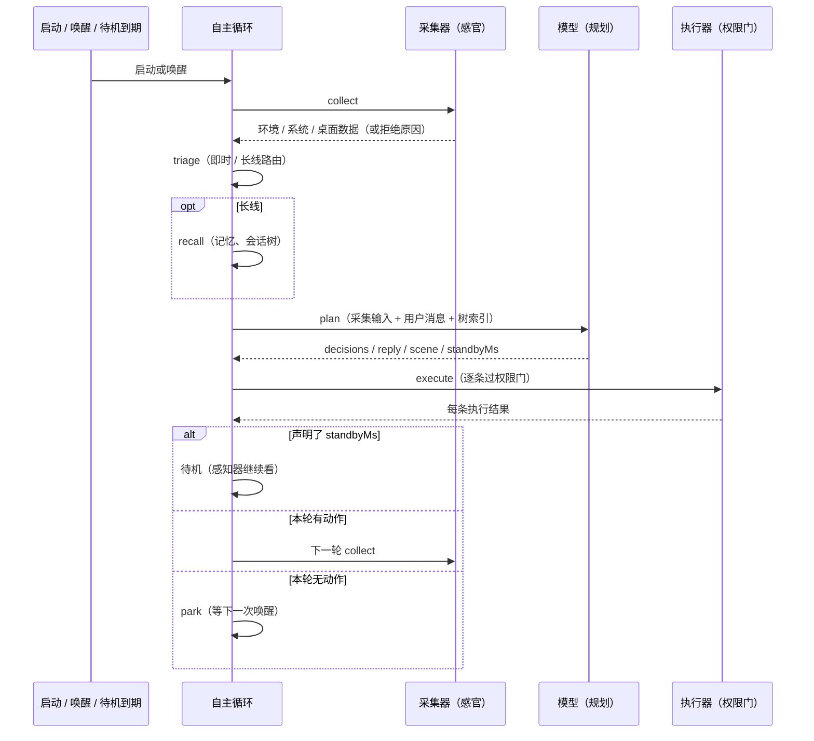
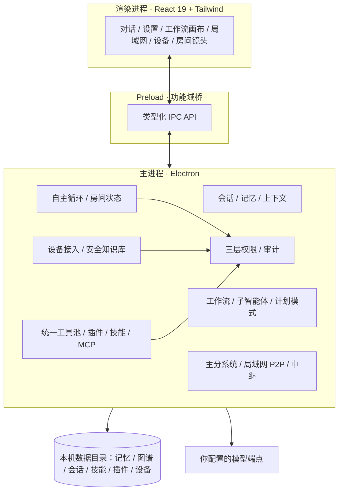
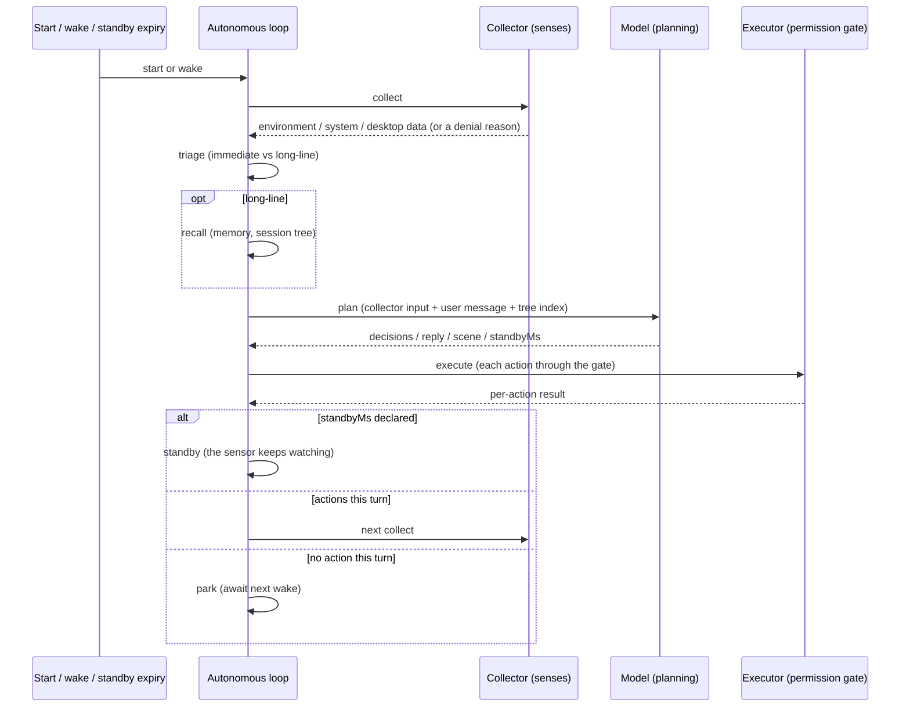

<div align="center">


# 月蚀 · LunarEclipse

**月相会告诉你时间，记忆会告诉她你是谁。**

**v0.53.19 · AGPL-3.0-or-later · Windows x64**

[](https://github.com/Canaan-2023/lunareclipse/actions/workflows/ci.yml)
[](https://github.com/Canaan-2023/lunareclipse/releases)
[](./LICENSE)
[](#快速开始)
[](https://www.electronjs.org/)
[](#从源码运行)

[下载最新版](https://github.com/Canaan-2023/lunareclipse/releases) ·
[问题反馈](https://github.com/Canaan-2023/lunareclipse/issues) ·
[参与贡献](./CONTRIBUTING.md) ·
[安全策略](./SECURITY.md)

</div>

---

<p align="center">
  
  <br />
  <sub>月蚀的房间 · 落地窗外是月蚀与城市</sub>
</p>

## 它是什么

月蚀是一个运行在 Windows 上的**本机优先桌面 AI 智能体**（Electron 44 + React 19 + TypeScript）。
它把对话、长期记忆、工具、工作流、多 AI、局域网与设备接入放在同一个本机工作台里。

- **自主模式是核心能力**：AI 在自己的房间里观察环境、规划并执行；过程实时可见，随时可停。
- **长期记忆**：原始对话逐字保留，记忆流水线做价值判断、定位与质量审查，日记线与图谱线双路检索。
- **多个 AI**：每个 AI 有独立的记忆、提示词、会话和房间，会话可切换归属。
- **本机数据**：会话、记忆和配置保存在本机；月蚀没有自己的云端账户系统。
  使用云端模型时，请求会发送给你配置的模型服务商。
- **权限边界**：文件、命令、设备、局域网、采集器默认拒绝，需要你显式授权。
- **可改造**：工作流、插件、技能、MCP、模型路由和房间外观都可以替换或扩展。

## 月蚀的形象

房间里的月蚀是白发紫瞳的少女，带着一只黑猫和月相头饰。内置素材包括：

- **全身立绘**：`src/assets/default-character.png`，没有自定义立绘时作为默认形象；
- **两张背景**：`背景1` / `背景2`，只在舞台底部手动切换；`scenes/` 里的图片按真实文件名成为选项，不再随 AI 活动自动跳；
- **Q 版头像与表情**：登录页头像与角色卡，用于识别与展示；
- **应用图标**：窗口、任务栏与 exe 资源使用同一张月蚀图标。

<table align="center">
  <tr>
    <td width="50%" align="center" valign="top">
      
      <br />
      <sub>角色卡 · 立绘 / 三视图 / 细节 / 表情</sub>
    </td>
    <td width="50%" align="center" valign="top">
      
      <br />
      <sub>Q 版 · 表情 / 动作 / 小物设定</sub>
    </td>
  </tr>
</table>

## 适合谁

- 想让 AI 长期记住自己的工作与偏好，而不是每次重新解释的人。
- 想让 AI 在授权范围内读写文件、运行命令、操作设备的人。
- 想把多步经验固化成工作流，或拆给多个子智能体的人。
- 想在多台机器之间同步记忆、消息与任务，而不经过公网服务器的人。
- 想改造界面、接入自己的模型或素材的开发者。

## 使用前需要知道

- 需要自行配置模型服务；月蚀不内置模型、密钥或云端账号。
- 当前面向单机与个人使用，不提供团队租户与集中审计。
- 自主模式仍受权限约束，不会无人值守地操作整台电脑。
- Windows x64 是当前分发目标；其他平台未验证。

## 核心能力

| 能力 | 说明 |
| --- | --- |
| **长期记忆** | 原始对话逐字归档；记忆流水线做价值判断、定位与质量审查；日记线 + 图谱线双路检索。 |
| **多个 AI** | 每个 AI 有独立记忆、提示词、会话与房间；会话可在 AI 之间切换归属。 |
| **会话树** | 用户会话 + AI 内部会话；上下文触顶时继承、冻结、可回翻，另有时间分叉轴。 |
| **工作流 / 子智能体** | DAG 节点（`llm` / `tool` / `skill` / `condition` / `human` / `answer` / `end`），可视化编排；子智能体并发池。 |
| **计划模式** | 先只读调研并给出方案，确认后才执行；多步改动先过目。 |
| **自主模式** | 采集 → 分诊 → 回忆 → 规划 → 执行 → 待机/继续；多唤醒源、可见输出、随时可停。 |
| **模型路由** | AUTO 在模型池内按轮切换，带最小驻留与切换审计；支持余额探测（服务商提供端点时）。 |
| **局域网协作** | 主/分系统、好友私聊与文件传输、邀请制聊天室、公示板、可选中继与最短路径转发。 |
| **设备接入** | 扫描 → 注册 → 调用；只读 `info` 直接执行，`control` 按风险走授权门。 |
| **安全工具** | 可挂载的本地安全知识库、授权策略门、MITRE ATT&CK 阶段映射；仅对已授权目标生效。 |
| **插件 / 技能 / MCP** | 目录即插件、渐进式技能、MCP 工具并入统一注册表，同样经过权限闸门。 |
| **房间与外观** | 月蚀立绘、按真实文件名切换的背景、GALGAME 式记录抽屉；Live2D 可自备。 |
| **可选集成** | 飞书长连接、终端 TUI。 |

## 自主模式

自主模式是月蚀的核心能力。房间是它的观察窗口，不是另一套机制。



### 它是怎么被唤醒的

唤醒源包括：启动、用户消息、用户到达/操作、监控事件、手动“立即行动”、系统恢复、
待机到期，以及采集器感知到环境变化。正在跑的一轮期间到达的唤醒不会丢，park 后会补跑。

- **不是定时轮询**：没有变化时安静待机；变化发生时才被唤醒。
- **感知器只做廉价采样**：空闲时观察 CPU / 可用内存（视图含网络时还看本应用传输计数），
  不调用模型、不起子进程；采样间隔与阈值可由 AI 自己配置，也可以屏蔽某个信号。
- **待机不等于闭眼**：AI 可以声明 `standbyMs`，但感知器仍会观察，环境变化可提前叫醒它。
- **由 AI 决定有没有任务**：规划结果为空就继续待机，不产生空动作。
- **用户消息是一等输入**：即使采集器未授权或未开启，你在房间里发的消息也会进入规划。
- **过程可见**：每次唤醒、规划、执行和失败都会进入输出带与记录；停止后不会再有新动作落地。

### 房间里看到什么

| 你看到的 | 实际对应 |
| --- | --- |
| 角色的姿态（待机 / 工作 / 思考） | AI 的 `scene.action` 或本轮阶段；背景固定由你手动选 |
| 底部字幕 | 计划里的 `reply`（或 `scene.say`） |
| 常驻输出带 | 真实的循环事件：唤醒、采集、分诊、规划、执行、回复、待机/park |
| 顶栏开关 | 启动 / 停止自主循环；停止后消息回到普通会话 |
| 「记录」抽屉 | 完整事件流，可回看 |

角色的移动和姿态是 UI 表现，不改变权限，也不替代执行器。

### 当前边界

- 空闲感知只看 CPU / 内存（以及视图含网络时的本应用传输）；磁盘、GPU、进程的完整采集
  只在被拉起时发生。
- 自主循环没有固定的“重复 3 次”或“单次 12 轮”上限；相同计划会先陈述事实，
  由 AI 写 `repeat: continue / stop` 决定继续还是收束。
- 语义刹车保留：无输入、无动作、全部动作被拒、模型失败、用户停止。
- 没有“一键全自动”：T0 硬禁止不可授予，T1 需要逐项授予。

## 权限与边界

每个受控动作经过**同一个 policy 检查点**：返回一个裁决，写一条审计。

| 层级 | 含义 | 默认 |
| --- | --- | --- |
| **T0 硬禁止** | 攻击非授权第三方、隐蔽规避、伤害他人、伪造身份、未声明外泄、绕过审批（含 AI 自我授权） | **永远关闭**，不可授予，不注册为工具 |
| **T1 显式授予** | 采集、执行器高风险动作、已授权目标探测、数据删除、跨节点迁移、已声明端点传输、使用凭据、工具区产物、中继、遥测开关、模型配置、局域网启停 | **默认关**，逐项授予、可撤回、可带范围、全量审计 |
| **T2 默认开** | 只读环境元数据、规划、记忆检索、拓扑可视化、只读工具、日志/审计读取、池内选模型、房间外观 | 无需授予 |

- 授予只来自你的操作；AI 不能给自己授权。
- 撤回永远不需要前置条件；收紧权限的方向永远畅通。
- 未授予 T1 时，自主模式只做感知、规划与只读动作。
- 采集器是**两层闸门**：用户开关 + `t1.collector` 授予，两层都开才会读取环境。
- `t1.migrate` 会列出当前局域网节点供勾选；目标 / 端点也提供 IP、URL、共享路径示例。
  你填进去的范围就是 AI 能访问的范围，不在范围内一律拒绝。
- 授予前需要阅读并确认告知条款；授权造成的损失由你自行承担。

## 模型、工作流与子智能体

- **模型配置**：设置 → 前端 AI / 后端 AI，填写 `baseURL` / `apiKey` / `model`，可测试连接。
  不配置模型时，对话不可用，但应用其余部分可以打开。
- **AUTO 路由**：在模型池内按轮选择模型，带最小驻留、失败兜底和切换审计；
  余额探测只对提供余额端点的服务商生效，其余如实显示未知。
- **工作流**：DAG 画布支持 `llm`、`tool`、`skill`、`condition`、`human`、`answer`、`end`
  节点；可把多步经验固化成模板。
- **子智能体**：并发池执行子任务，结果回收到主流程。
- **计划模式**：先只读调研，给出方案，确认后再执行。

## 局域网与设备

- **局域网**：主/分系统、好友私聊与文件传输、邀请制聊天室、公示板；
  节点自动发现、拓扑同步、按最短路径转发，是否愿意中继由各自所有者授权。
- **设备接入**：扫描 → 注册 → 调用；只读 `info` 直接执行，`control` 走风险分级授权门。
- **安全工具**：本地安全知识库与 MITRE ATT&CK 阶段映射，用于授权范围内的检查与演练；
  只对已授权目标生效，所有受控动作留审计。

## 插件、技能与 MCP

- **插件**：目录即插件，按约定加载。
- **技能**：渐进式加载，按任务需要展开。
- **MCP**：外部工具并入统一注册表，和内置工具一样经过权限闸门。
- **可选集成**：飞书长连接、终端 TUI。

## 房间与外观

<table align="center">
  <tr>
    <td width="50%" align="center" valign="top">
      
      <br />
      <sub><b>背景1</b> · 卧室与落地窗</sub>
    </td>
    <td width="50%" align="center" valign="top">
      
      <br />
      <sub><b>背景2</b> · 工作室与陈列</sub>
    </td>
  </tr>
</table>

- **背景按真实文件名**：`<data>/room/AI{n}/scenes/` 里的 PNG / JPEG 直接成为选项
  （`背景1.jpg` → `背景1`）。只在舞台底部手动切换；AI 的 `scene.zone` 仍影响姿态与行为，但**不再改变背景**。
- **形象来源**：默认「立绘」（内置月蚀立绘，或 `<data>/room/AI{n}/mascot` 下的图片帧）；
  也可以切到「Live2D」，使用你自备的模型与 Cubism Core。
- **Live2D 边界**：运行时与渲染器保留，但**安装包不再内置模型与 Core**。
  把模型放到 `<data>/room/AI{aiId}/live2d/`（或全局 `<data>/room/live2d/`），再在面板里切到 Live2D。
- **舞台操作**：拖动 = 横向 / 高度，`Shift + 拖动` = 纵深，滚轮 = 缩放；松手自动保存。
- **记录**：顶栏「记录」打开 GALGAME 式 LOG 抽屉；输出带贴底跟随，上翻不被新行拽回。

## 快速开始

### 直接使用

1. 从 [Releases](https://github.com/Canaan-2023/lunareclipse/releases) 下载最新的 Windows x64 压缩包。
2. 解压到任意目录，运行 `LunarEclipse.exe`。
   首次启动会在程序旁生成 `data/abyssac_data/`（记忆、图谱、房间素材）与 `data/userdata/`（配置、会话、日志）。
3. **配置模型**：设置 → 前端 AI / 后端 AI，填写 `baseURL` / `apiKey` / `model`，点“测试连接”。
4. **阅读并确认权限告知**：设置 → 权限。授予任何 T1 之前需要先确认条款。
5. **进入自主模式（可选）**：设置 → 自主房间 → 进入，或输入区模式菜单选“自主”；
   点顶栏开关启动。想让 AI 感知环境，需要同时打开采集器开关并授予 `t1.collector`。
6. **清空本机状态**：退出应用后删除 `data/`。
7. **迁移**：整体复制程序目录即可。

分发版内置**月蚀立绘与两张背景（背景1 / 背景2）**，首次启动会按「用户文件不覆盖、旧版随包素材可升级」写入数据目录。
**Live2D 模型与 Cubism Core 不随包分发**：需要时把你的模型放进 `data/abyssac_data/room/live2d/`，
在「形象与背景 → 形象来源」里切到 Live2D。

> exe 未做代码签名，首次运行可能出现 Windows SmartScreen 提示；
> 选择“更多信息 → 仍要运行”即可。

### 从源码运行

要求：**Windows 10/11 x64**、Node.js 22.13 或更高（当前开发使用 24）、npm。
仓库根目录就是应用根，克隆后直接安装依赖：

```bash
npm ci
npm run dev
```

国内网络可使用镜像，二选一：

```bash
npm ci --registry=https://registry.npmmirror.com
# 或先替换为镜像锁：
#   copy package-lock.npmmirror.json package-lock.json   （Windows）
#   cp   package-lock.npmmirror.json package-lock.json   （macOS / Linux）
```

常用脚本：

```bash
npm run typecheck  # 类型检查（node + web + test）
npm run test:unit  # 单元测试（排除 e2e）
npm run lint       # ESLint
npm run build      # 构建到 out/（electron-vite）
```

当前基线：**301 文件 / 3413 用例**通过。

源码版同样使用内置月蚀立绘与 `assets/room-seed` 的两张背景（`背景1.jpg` / `背景2.jpg`）：`npm run dev` 首次启动会把它们写入
`data/abyssac_data/room/`（用户文件不会被覆盖）。你也可以把自己的素材放进 `data/abyssac_data/room/`。

## 架构



数据落在程序目录旁的 `data/`（业务数据 + 运行时数据）；整体复制程序目录即为完整迁移。

## 常见问题

**找不到权限授予入口？**
设置左侧的 Tab 列表可滚动，权限页在靠下位置；房间信息 → 授权页挂载的是同一个面板。

**采集器勾选打开了，AI 还是不能采集？**
采集器有两层：用户层开关（设置 → 自主房间 → 采集器）与 AI 侧授予 `t1.collector`。
两层都打开才生效；采集器分区会显示授权状态并提供跳转。

**授予权限时“范围”不知道填什么？**
`t1.migrate` 会列出当前局域网节点供勾选；目标 / 端点提供 IP、URL、共享路径示例，也可以手填。
填进去就等于授权访问它，不在列表里的一律拒绝。已授予后可以点「更新范围」，不必先撤回。

**在房间里发消息，AI 没回应？**
先确认顶栏开关是“开启”而不是“已停止”；再看输出带是否出现“收到你的消息 / 回复 /
规划无动作 / LLM 未回复”。若仍未回应，检查模型是否配置、是否在失败后停止。

**为什么切换 Live2D 后没有模型？**
安装包不再内置模型与 Cubism Core。把模型放进 `data/abyssac_data/room/live2d/`
（`model/*.model3.json` + 贴图 + `live2dcubismcore.min.js`），再点「重新读取」并在形象来源里选 Live2D。
没有模型时请保持「立绘」，内置月蚀立绘始终可用。

**为什么没有“一键全自动”？**
T0 硬禁止不可授予，T1 需要逐项授予。这是产品边界，不是配置遗漏。

## 参与

- **Bug / 功能建议**：使用 [Issues](https://github.com/Canaan-2023/lunareclipse/issues/new/choose)
  提交，附版本号、系统版本、复现步骤和日志；提问前先看 [SUPPORT.md](./SUPPORT.md)。
- **安全漏洞**：不要开公开 Issue，按 [SECURITY.md](./SECURITY.md) 私密报告。
- **代码贡献**：先读 [CONTRIBUTING.md](./CONTRIBUTING.md)，并遵守
  [CODE_OF_CONDUCT.md](./CODE_OF_CONDUCT.md)。

## 许可证

本项目以 **AGPL-3.0-or-later** 发布，完整文本见 [`LICENSE`](./LICENSE)。

运行时依赖、Live2D 条款与月蚀美术说明见 [`THIRD-PARTY-NOTICES.md`](./THIRD-PARTY-NOTICES.md)；
依赖许可证全文与 Live2D 条款在 [`licenses/`](./licenses/)，随源码包与分发夹一起提供。

---

# English

# LunarEclipse 月蚀

**v0.53.19 · AGPL-3.0-or-later · Windows x64**

**The moon tells the time; memory tells her who you are.**

LunarEclipse is a local-first desktop AI agent for Windows (Electron 44 + React 19 + TypeScript).
It puts conversation, long-term memory, tools, workflows, multiple AIs, LAN collaboration and
device access in one local workbench.

- **Autonomous mode is the core capability**: the AI observes its environment, plans and acts in its own room, with the process visible in real time and stoppable at any moment.
- **Long-term memory**: the raw conversation is kept verbatim, with a memory pipeline for value judgment, localization and quality review, retrieved along journal and graph tracks.
- **Multiple AIs**: each AI has its own memory, prompts, sessions and room; a conversation can be reassigned between AIs.
- **Local data**: sessions, memory and config stay on your machine. LunarEclipse has no cloud account of its own; when you use a hosted model, requests go to the provider you configured.
- **Explicit boundaries**: files, commands, devices, LAN and the environment collector are deny-by-default and require your explicit grant.
- **Extensible**: workflows, plugins, skills, MCP, model routing and the room appearance can all be replaced or extended.

## Before you start

- You bring your own model service; LunarEclipse ships with no model, API key or cloud account.
- It is aimed at a single machine and personal use; it does not provide team tenants or centralized audit.
- Autonomous mode stays within the permission system; it does not operate the whole computer unattended.
- Windows x64 is the current distribution target; other platforms are not verified.

## Capabilities

| Capability | What it does |
| --- | --- |
| **Long-term memory** | Verbatim raw archive; a pipeline for value judgment, localization and quality review; journal + graph retrieval. |
| **Multiple AIs** | Each AI has its own memory, prompts, sessions and room; conversations can be reassigned. |
| **Session tree** | User sessions plus an internal AI session pool; contexts inherit, freeze and can be browsed back, with a time-fork axis. |
| **Workflows / sub-agents** | DAG nodes (`llm` / `tool` / `skill` / `condition` / `human` / `answer` / `end`) on a visual canvas; a concurrency pool for sub-agents. |
| **Plan mode** | Read-only investigation and a plan first; execution happens only after approval. |
| **Autonomous mode** | collect → triage → recall → plan → act → standby/continue; multiple wake sources, visible output, stop at any time. |
| **Model routing** | AUTO switches models inside the pool per turn, with minimum dwell and switch audit; balance probing where the provider exposes it. |
| **LAN collaboration** | Master/satellite, friend DMs and file transfer, invite-only rooms, a publish board, optional relay and shortest-path forwarding. |
| **Device access** | scan → register → call; read-only `info` runs directly, `control` goes through the risk-tiered gate. |
| **Security tooling** | A mountable local knowledge base, an authorization gate and MITRE ATT&CK stage mapping; authorized targets only. |
| **Plugins / skills / MCP** | Folder-based plugins, progressive skills, MCP tools in the same registry and behind the same gates. |
| **Room & appearance** | LunarEclipse portrait, two manually switched backgrounds, a visual-novel-style log drawer; Live2D is bring-your-own. |
| **Optional integrations** | A Lark (Feishu) long connection and a terminal TUI. |

## Autonomous mode

Autonomous mode is the core of LunarEclipse. The room is its observation window, not a separate mechanism.



### How it wakes

Wake sources include startup, your messages, your presence/activity, monitor events, a manual
"act now", system resume, standby expiry and environment changes sensed by the collector.
A wake that arrives while a turn is running is not lost; it is replayed after the turn parks.

- **Not a fixed timer**: it stays quiet when nothing changes and wakes only when something happens.
- **The sensor only takes cheap samples**: while idle it watches CPU / free memory (and this app's
  network counters when the network view is open) without calling the model or spawning processes;
  intervals and thresholds are configurable by the AI, and individual signals can be muted.
- **Standby is not "eyes closed"**: the AI may declare `standbyMs`, but the sensor keeps watching
  and a change can wake it early.
- **The AI decides whether there is a task**: an empty plan means more standby, never an empty action.
- **Your message is a first-class input**: a message you type in the room enters planning even when
  the collector is not granted or enabled.
- **Visible**: every wake, plan, action and failure goes to the output strip and the log; after
  stopping, no new action lands.

### What you see in the room

| What you see | What it actually is |
| --- | --- |
| The character's pose (idle / working / thinking) | The AI's `scene.action` or the current stage; the background is always your manual choice |
| Subtitles at the bottom | The plan's `reply` (or `scene.say`) |
| The persistent output strip | Real loop events: wake, collect, triage, plan, execute, reply, standby/park |
| The top switch | Start / stop the loop; after stopping, messages return to the normal chat |
| The "Record" drawer | The full event stream, replayable |

The character's movement and poses are UI presentation; they do not change permissions or replace
the executor.

### Current boundaries

- Idle sensing only watches CPU / memory (and this app's network counters when the network view is
  open); the full collection of disk, GPU and processes happens only when the loop is engaged.
- There is no fixed "repeat 3 times" or "12 turns" cap; for a repeated plan the AI states the facts
  and writes `repeat: continue / stop` to decide whether to keep going.
- Semantic brakes remain: no input, no action, all actions denied, model failure, or the user stops.
- There is no "one-click full auto": T0 is never grantable and T1 is granted item by item.

## Permissions and boundaries

Every controlled action passes through a single policy checkpoint: one decision returned, one audit
record written.

| Tier | Meaning | Default |
| --- | --- | --- |
| **T0 hard limits** | Attacking non-authorized third parties, covert evasion, harming others, identity forgery, undeclared exfiltration, bypassing approval (including self-granting permissions) | **Always off**, not grantable, not registered as tools |
| **T1 explicit grant** | Collection, high-risk executor actions, probing authorized targets, data deletion, cross-node migration, transfer to declared endpoints, using credentials, AI-built tool artifacts, relaying, telemetry toggles, model configuration, LAN start/stop | **Off by default**, granted item by item, revocable, scope-able, fully audited |
| **T2 default on** | Read-only environment metadata, planning, memory retrieval, topology visualization, read-only tools, log/audit reading, choosing a model inside the pool, room appearance | No grant required |

- Grants only come from your actions; the AI cannot grant itself permissions.
- Revoking never needs a precondition; tightening permissions is always available.
- Without T1, autonomous mode only senses, plans and performs read-only actions.
- The collector has two gates: the user switch and the `t1.collector` grant — both must be open.
- `t1.migrate` lists the current LAN nodes to pick from; for targets/endpoints it offers IP, URL and
  shared-path examples. The scope you set is the boundary; anything outside it is denied.

## Models, workflows and sub-agents

- **Model setup**: Settings → frontend AI / backend AI, fill in `baseURL` / `apiKey` / `model` and
  test the connection. Without a model, chat is unavailable but the rest of the app opens.
- **AUTO routing**: picks a model per turn inside the pool, with minimum dwell, a failure fallback
  and switch audit; balance probing only works for providers that expose a balance endpoint.
- **Workflows**: the DAG canvas supports `llm`, `tool`, `skill`, `condition`, `human`, `answer`,
  `end`; turn multi-step experience into reusable templates.
- **Sub-agents**: a concurrency pool runs sub-tasks and collects results back into the main flow.
- **Plan mode**: investigate read-only and present a plan, then execute only after approval.

## LAN and devices

- **LAN**: master/satellite, friend DMs and file transfer, invite-only rooms and a publish board;
  nodes discover each other, topology syncs, and messages follow the shortest path. Whether to relay
  is authorized by each machine's owner.
- **Device access**: scan → register → call; read-only `info` runs directly, `control` goes through
  the risk-tiered gate.
- **Security tooling**: a local knowledge base and MITRE ATT&CK stage mapping for checks and drills
  within the authorized scope; authorized targets only, every controlled action audited.

## Plugins, skills and MCP

- **Plugins**: a folder is a plugin, loaded by convention.
- **Skills**: loaded progressively, expanded when a task needs them.
- **MCP**: external tools join the same registry and pass through the same permission gates.
- **Optional integrations**: a Lark (Feishu) long connection and a terminal TUI.

## Room and appearance

- **Two backgrounds**: Background 1 / Background 2, switched manually from the stage footer. The AI's
  `scene.zone` still drives pose and behaviour, but **never changes the background**, so it no
  longer jumps every loop. Files under `scenes/` become menu entries by their real filename
  (`背景1.jpg` → `背景1`).
- **Character source**: default **Portrait** (the built-in LunarEclipse art, or image frames under
  `<data>/room/AI{n}/mascot`); you can switch to **Live2D** with a model you provide.
- **Live2D boundary**: the renderer and runtime remain, but **the installer no longer bundles a
  model or Cubism Core**. Put yours under `<data>/room/AI{aiId}/live2d/` (or global
  `<data>/room/live2d/`), then select Live2D in the appearance panel.
- **Stage controls**: drag = horizontal / height, Shift-drag = depth, scroll = zoom; position saves
  when you let go.
- **Record**: the top "Record" opens a visual-novel-style log drawer; the output strip stays pinned
  to the bottom and isn't yanked back when you scroll up.

## Quick start

### Using the build

1. Download the latest Windows x64 archive from
   [Releases](https://github.com/Canaan-2023/lunareclipse/releases).
2. Extract anywhere and run `LunarEclipse.exe`. On first launch it creates `data/abyssac_data/`
   (memory, graph, room assets) and `data/userdata/` (config, sessions, logs) next to the program.
3. **Configure your model**: Settings → frontend AI / backend AI, fill in `baseURL` / `apiKey` /
   `model` and test the connection.
4. **Read and confirm the permission notice**: Settings → Permissions. Confirm before granting any T1.
5. **Enter autonomous mode (optional)**: Settings → Autonomous Room → Enter, or choose "Autonomous"
   in the input mode menu, then use the top switch. To let the AI sense the environment, turn on the
   collector switch and grant `t1.collector`.
6. **Clear local state**: quit and delete `data/`.
7. **Migration**: copy the whole program folder.

The build ships with the **LunarEclipse portrait and two backgrounds (Background 1 / Background 2)**. On first launch they are
written into the data folder as "user files are never overwritten; our own old seed assets may be
upgraded". **Live2D models and the Cubism core are not bundled**: put yours under
`data/abyssac_data/room/live2d/` and select Live2D in the appearance panel.

> The exe is not code-signed; if Windows SmartScreen appears, choose "More info → Run anyway".

### Run from source

Requires **Windows 10/11 x64**, Node.js 22.13 or newer (development uses 24), and npm. The repository
root is the app root; install dependencies directly after cloning:

```bash
npm ci
npm run dev
```

On slow networks in China:

```bash
npm ci --registry=https://registry.npmmirror.com
# or swap in the mirror lockfile first:
#   cp package-lock.npmmirror.json package-lock.json   (macOS / Linux)
#   copy package-lock.npmmirror.json package-lock.json  (Windows)
```

Common scripts:

```bash
npm run typecheck  # type checking (node + web + test)
npm run test:unit  # unit tests (e2e excluded)
npm run lint       # ESLint
npm run build      # build into out/ (electron-vite)
```

Current baseline: **301 files / 3413 tests** passing.

The source build uses the same built-in portrait and `assets/room-seed` backgrounds:
`npm run dev` seeds them into `data/abyssac_data/room/` on first launch (user files are not
overwritten). You can also put your own assets there.

## FAQ

**I can't find the permission grants?**
The settings tab list on the left scrolls; the permissions page is toward the bottom. The room info
→ authorization page mounts the same panel.

**I turned the collector on, but the AI still can't collect?**
The collector has two gates: the user switch (Settings → Autonomous Room → Collector) and the
`t1.collector` grant. Both must be open; the collector panel shows the status and a shortcut.

**I don't know what to put in the grant "scope"?**
`t1.migrate` lists the current LAN nodes to pick from, and targets/endpoints offer IP / URL /
shared-path examples (you can also type your own). What you put in is the scope; anything outside it
is denied. You can press "Update scope" after granting, without revoking first.

**The AI doesn't respond to messages in the room?**
First confirm the top switch is "on" rather than "stopped"; then check the output strip for
"message received / reply / no action / LLM not responding". If it still stays silent, check the
model configuration and whether it stopped after a failure.

**Why is there no model after switching to Live2D?**
The installer no longer bundles a model or the Cubism core. Put yours under
`data/abyssac_data/room/live2d/` (`model/*.model3.json` + textures + `live2dcubismcore.min.js`),
hit Reload, and select Live2D as the character source. The built-in portrait always works without it.

**Why is there no "one-click full auto"?**
T0 is never grantable and T1 is granted item by item. This is a product boundary, not a missing setting.

## Contributing

- **Bugs / feature requests**: open an [Issue](https://github.com/Canaan-2023/lunareclipse/issues/new/choose)
  with the version, OS build, reproduction steps and logs; read [SUPPORT.md](./SUPPORT.md) first.
- **Security vulnerabilities**: do not open a public issue; report privately per
  [SECURITY.md](./SECURITY.md).
- **Code contributions**: read [CONTRIBUTING.md](./CONTRIBUTING.md) and follow the
  [CODE_OF_CONDUCT.md](./CODE_OF_CONDUCT.md).

## License

Released under **AGPL-3.0-or-later**; the full text is in [`LICENSE`](./LICENSE).

The sources and licenses of runtime dependencies, Live2D terms and the LunarEclipse artwork are
listed in [`THIRD-PARTY-NOTICES.md`](./THIRD-PARTY-NOTICES.md); full dependency licenses and the
Live2D terms are in [`licenses/`](./licenses/), shipped with both the source and the downloadable build.
